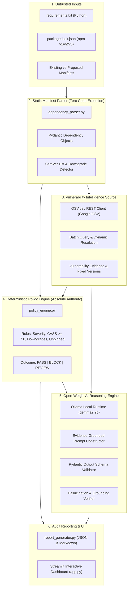

# LockSentry AI — Architecture & Technical Design

## 1. Executive Architecture Summary

LockSentry AI is an AI-assisted software dependency security gate designed to intercept dependency manifest and lockfile changes before code is merged into production environments.

The architecture strictly adheres to a **deterministic security precedence principle**:
- **Deterministic Security Rules** enforce non-negotiable security boundaries (vulnerabilities, downgrades, unpinned dependencies) with absolute veto authority.
- **Open-Weight AI (Google Gemma 2 2B)** operates as an evidence-grounded reasoning and trade-off analyzer. It contextualizes risk, evaluates migration trade-offs, identifies uncertainty gaps, and generates structured explanations for human maintainers.
- **The model NEVER overrides deterministic security decisions.**

---

## 2. Component Architecture Diagram

---

## 3. Data Flow & Processing Lifecycle

1. **Ingestion & Static Parsing**:
   - The user supplies an individual manifest or a comparative pair (Existing vs Proposed).
   - Parsing is performed strictly using static string analysis and JSON parsing. No setup scripts, pre-install hooks, or repository code are ever executed.
   - Pinned versions, version constraints, ecosystem (`PyPI` or `npm`), and development flags are extracted into immutable `Dependency` data models.

2. **Differential Analysis**:
   - In comparative mode, `compare_dependencies()` computes semantic differences, classifying each dependency into `ADDED`, `REMOVED`, `UPDATED`, `DOWNGRADED`, or `UNCHANGED`.
   - Major semantic version jumps (e.g. `1.x` to `2.x`) are flagged for breaking change review.

3. **Vulnerability Intelligence Retrieval (OSV.dev)**:
   - Queries the official Google OSV API (`https://api.osv.dev/v1/query` and `querybatch`).
   - Retrieves verified records including CVE aliases, GHSA IDs, CVSS scores, affected version ranges, and documented fixed versions.
   - For unpinned dependencies, records ambiguity explicitly rather than assuming zero risk.

4. **Deterministic Policy Gate Evaluation**:
   - The `DeterministicPolicyEngine` evaluates every dependency against configurable rules:
     - **BLOCK**: Confirmed vulnerabilities meeting severity thresholds (CRITICAL, HIGH, CVSS >= 7.0), any confirmed vulnerable proposed package, or unauthorized version downgrades.
     - **REVIEW**: Unpinned floating dependencies, major breaking bumps, or OSV lookup failures.
     - **PASS**: All packages pinned with zero known advisories in the database.
   - Aggregate decision: If any item is `BLOCK`, the gate outcome is `BLOCK`. If any item is `REVIEW`, the gate outcome is `REVIEW`. Only when all items pass is the outcome `PASS`.

5. **Open-Weight AI Reasoning Engine**:
   - Connects to a verified local instance of **Google Gemma 2 2B** (`gemma2:2b`) running via Ollama (`http://localhost:11434`).
   - Supplies the model with verified OSV evidence and the deterministic policy outcome in a structured JSON prompt.
   - Receives structured JSON adhering to `AIAnalysisReport` schema.
   - Runs a post-generation **Grounding Verification Check** that verifies every referenced package and CVE exists in the verified OSV input data. Any discrepancy is flagged as an ungrounded claim.
   - If Ollama is offline or inference fails, the system executes an automated **Deterministic Fallback**, ensuring the security gate never fails open.

6. **Audit Export & UI Presentation**:
   - Results are presented in an interactive Streamlit dashboard (`app.py`) with badge indicators, KPI cards, deep-dive tabs, and live inference verification status.
   - Complete audit logs are exportable as machine-readable JSON (`locksentry_report.json`) and audit-ready Markdown (`locksentry_report.md`).
